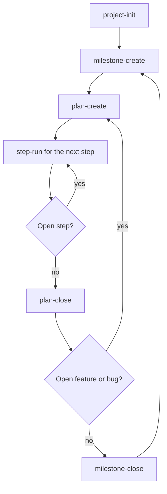

# AI template

This repository is a template for software projects that AI coding agents build. It works with Claude Code, Codex and Kilo, for a project in any language.

The template gives the agents a fixed procedure: milestones, plans, steps, reviews and gates. Python tools make each state change and commit it. The agents write the code, and you make the decisions.

## Contents
| Path | Content |
|---|---|
| `AGENTS.md` | Agent instructions for each provider |
| `.agents/` | Source of the skills, the agent definitions, the hooks and the MCP servers |
| `.claude/`, `.codex/`, `.kilo/`, `CLAUDE.md`, `.mcp.json`, `kilo.jsonc` | Provider files that `python -m tools.provider` generates |
| `tools/` | Python tools for each state change, check and gate |
| `docs/*_CONVENTIONS.md`, `docs/REVIEW.md` | Rules for code, tests, documents and reviews |
| `docs/design/` | Your design documents |
| `docs/milestones/`, `docs/plans/` | Milestones, plans and their progress |
| `docs/wiki/` | Developer wiki of your product |

## Requirements
- Python 3.11 or later
- Git
- Node.js, for the Mermaid check of the wiki
- Claude Code, Codex or Kilo

## Use the template
1. Copy the repository into a new folder for your project.
2. Put your design documents into `docs/design/`. Describe the product, the platforms and the stack.
3. Run `python -m tools.setup` in the project folder. It installs the Python packages and the Git pre-commit hook.
4. Start an agent session in the project folder.
5. Tell the agent to run the skill `project-init`. It asks for the stack, the tools and the pipeline, then commits the bindings.
6. Tell the agent to run the skill `milestone-create` for your first milestone.
7. Tell the agent to run the skill `plan-create` for the features of the milestone.
8. Start a session in the worktree of the plan and run the skill `step-run` for each step.
9. Run the skill `plan-close` when no step is open. Run `milestone-close` when the milestone has no open feature and no bug.

Run `python -m tools.progress status` to see the next step.

## Your tasks
- Write and change the design documents.
- Answer the questions of the agents and approve changes to protected paths.
- Run the manual checks.
- Push the branches and the tags. No tool pushes.

## More information
- `docs/DOCS_CONVENTIONS.md`: the full procedure, the file formats and the tool reference
- `AGENTS.md`: the list of skills
