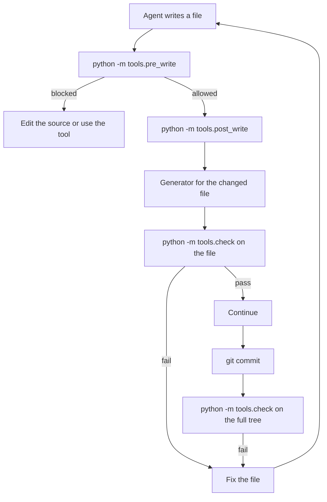

# Code conventions

Each rule has an id. A review problem names the id.

## Baseline rules
| ID | Rule |
|---|---|
| C001 | A change does what its step text says, not more and not less. |
| C002 | A change does not break a caller of the changed code. |
| C003 | A change reuses existing code. It does not duplicate a function, a type or a code path that exists. |
| C004 | A change does not expose data or secrets. |
| C005 | A change is as small as the step allows. A utility with one caller stays inline. |
| C006 | Handle only the errors that the runtime can cause. Do not handle errors that the architecture prevents. |
| C007 | No fallback, legacy path or migration without an entry in `DEPLOYMENT.md`. |
| C008 | No narrative comments. Tool-directed annotations only. |
| C009 | UI text follows `docs/design/`. A label is max 3 words. A tooltip is max 12 words. |
| C010 | Prefer the word type for a category in names, comments and rule texts. Use the word kind only when type already has a meaning in the same context. |
| C011 | Well designed: the wiki page of each module names in one sentence the decision that the module hides. The code holds no such sentence and no reference to a document. A change of that decision that the design or the open milestone names touches one module. A public function does not only forward its arguments to one other function. The dependencies between modules hold no cycle. |
| C012 | Extensible: a new instance of a type follows the row `DEP-01` of `docs/DEPENDENCIES.md`. An extension point has at least 2 users in the code or in the open milestone. Examples are a generic parameter, an interface, a registry or a switch. |
| C013 | A fix removes the cause of a defect. A longer limit, a retry, a tolerance or a delay is not a fix. |
| C014 | A step that adds an outside library, asset or code pattern checks its license against the free list of `tools/project.toml`. A license outside the list adds a row to `docs/LICENSES.md` in the same step. A license that the license answers of the bindings forbid blocks the step. |
| C015 | Maintainable: the step text names the modules that the change touches. The reviewer names each touched module that the step text does not explain. Each module has a test that calls it through its public interface only. One fact lives in one definition, and each user reuses it under C003. |

## Encoding rules
| ID | Rule |
|---|---|
| C100 | A text file is UTF-8 without a byte order mark. |
| C101 | A line ends with LF. |
| C102 | Source, documents and configuration hold ASCII characters only. A file that must hold non-ASCII characters has a row in the Non-ASCII allowlist. |
| C103 | A script passes the encoding `utf-8` when it opens a text file. |
| C104 | `python -m tools.fix_encoding` repairs a byte order mark, CRLF and Windows-1252. Replace a non-ASCII character by hand. |

## Tool rules
| ID | Rule |
|---|---|
| C200 | Run a tool in the form `python -m tools.<name>` from the repository root. |
| C201 | A tool file has an underscore name, for example `tools/step_close.py`. |
| C202 | A tool writes a file through a temporary file and a rename. |
| C203 | A tool is safe to run again. It continues from the first effect that is missing. |

## Check procedure

## Non-ASCII allowlist
| Path |
|---|
| docs/design/** |
| docs/research/** |
| docs/plans/**/evidence/** |
| docs/wiki/assets/** |
| DEPLOYMENT.md |

## Languages
`project-init` writes this table. `python -m tools.check` runs the formatter and the linter from `tools/project.toml`.

| Language | Formatter | Linter | Naming | Source | Tests |
|---|---|---|---|---|---|

## Project rules
The rules of the project start at C300.

| ID | Rule |
|---|---|
