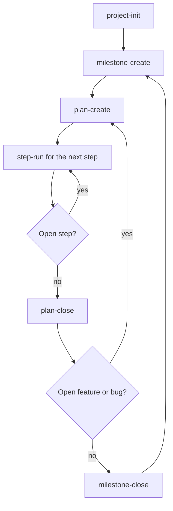
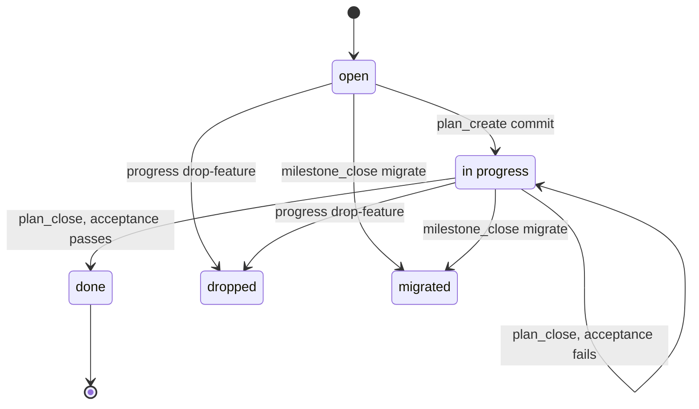
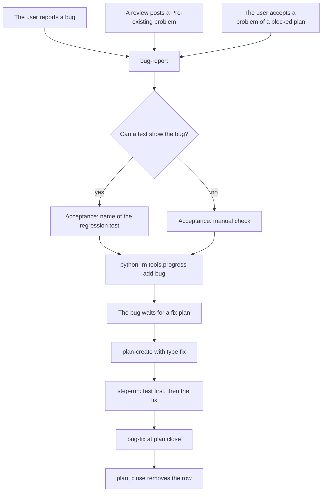
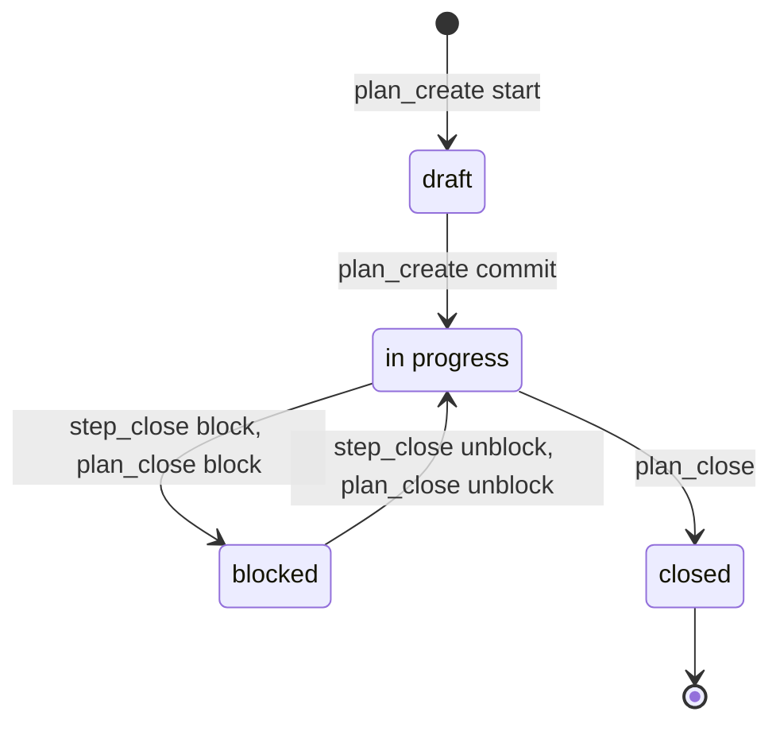
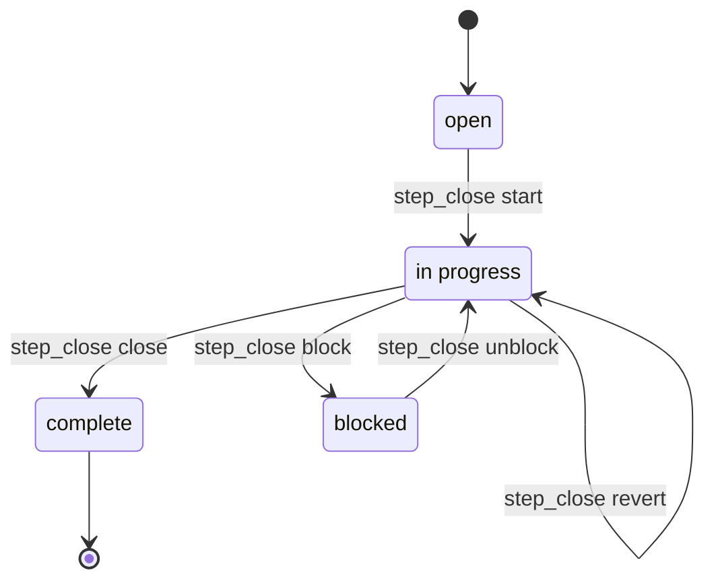
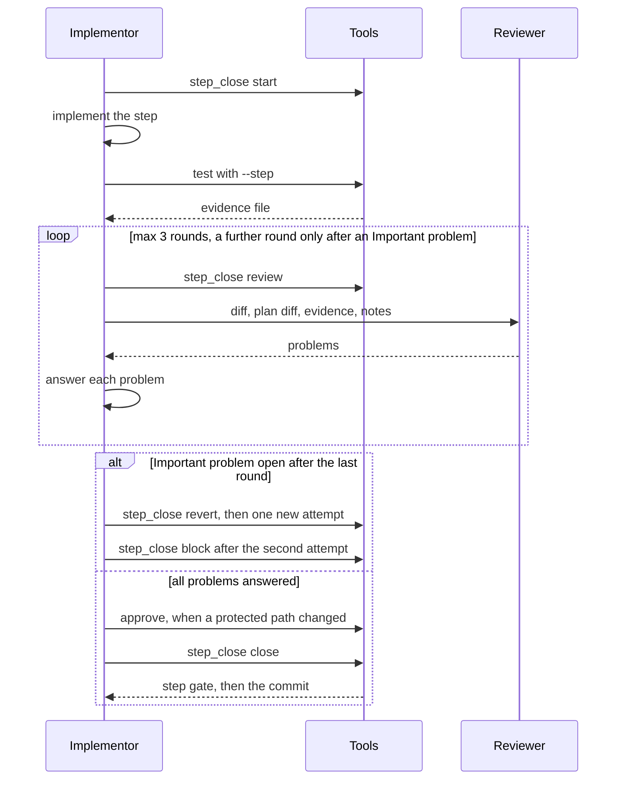
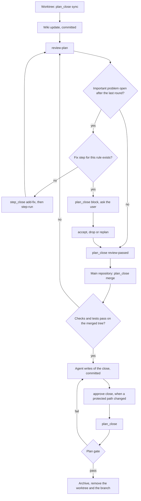
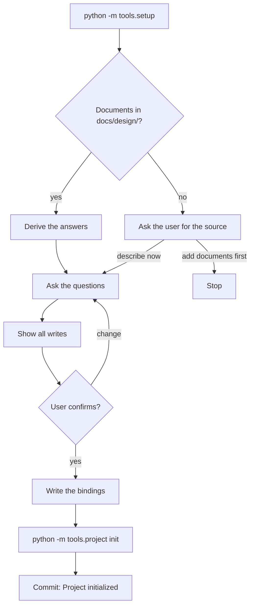

# Docs conventions

Each rule has an id. A review problem names the id.

## Writing rules
The writing rules follow ASD-STE100, Simplified Technical English.

| ID | Rule |
|---|---|
| D01 | A sentence has max 25 words. |
| D02 | Do not use a word or phrase of the blocklist in `tools/vale/styles/Project/Blocklist.yml`. |
| D03 | Write in active voice. |
| D04 | Write one instruction per sentence. |
| D05 | Use one word for one meaning. Do not use synonyms, idioms or figures of speech. |
| D06 | Use the technical names of the project: class names, tool names and protocol names. |
| D07 | A code identifier follows the naming rules of its language, not these rules. |
| D08 | A document shows a procedure with a Mermaid diagram. A diagram shows one procedure with its decision points. |
| D09 | A conventions file states rules only. Each rule has an id. |
| D10 | Research in `docs/research/` is input only. Text copied from it must pass the lint. The section Research file holds its frame. |

`python -m tools.docs_lint` runs Vale with the style in `tools/vale/styles/Project/`. Passive voice is a warning. The other checks fail. The lint does not check the text inside a code block. It fails when a Mermaid block does not parse.

## Lint exclusions
The docs lint covers `docs/**`, `AGENTS.md`, `.agents/**` and `CHANGELOG.md`. It excludes these paths.

| Path |
|---|
| docs/design/** |
| docs/research/** |
| docs/plans/**/evidence/** |
| docs/plans/**/tmp/** |
| docs/milestones/tmp/** |
| docs/wiki/assets/** |
| docs/wiki/index.html |

## Project structure
```
/AGENTS.md                                     (agent instructions for every provider)
/CLAUDE.md, /.claude/, /.codex/, /.kilo/       (generated provider files)
/.mcp.json, /kilo.jsonc                        (generated provider files)
/.agents/skills/[NAME]/SKILL.md                (skills, the source for every provider)
/.agents/agents/[NAME].md                      (agent definitions)
/.agents/hooks.yaml                            (hook definitions)
/.agents/mcp.yaml                              (approved MCP servers)
/.agents/.generated/manifest.json              (list and source hash of the generated files)
/tools/                                        (Python package with every tool)
/tools/project.toml                            (project bindings, written by project-init)
/tools/tests/                                  (tests of the tools, run with python -m unittest discover tools/tests)
/.worktrees/[PLAN ID]/                         (worktree of an active plan, not committed)
/docs/CODE_CONVENTIONS.md                      (how to write code)
/docs/TEST_CONVENTIONS.md                      (how to test)
/docs/DOCS_CONVENTIONS.md                      (how to plan, record and write, and the AI setup)
/docs/REVIEW.md                                (reviewer instructions)
/docs/ai-setup-adjustments.md                  (findings about the AI setup and the instructions to apply them)
/docs/DEPENDENCIES.md                          (structural dependencies of the project, written by tools.dependency)
/docs/MEMORY.md                                (memory index, generated)
/docs/memories/MEM-[NAME].md                   (one memory per file)
/docs/design/                                  (design documents of the user)
/docs/design/PROJECT.md                        (product, platforms and stack)
/docs/research/R[NNN]-[NAME].md                (one research file per question, input only)
/docs/research/tmp/                            (experiments of a research outside a plan, ignored by git)
/docs/milestones/PROGRESS.md                   (one row per milestone, generated)
/docs/milestones/M[NNN]-[NAME].md              (one milestone)
/docs/milestones/archive/                      (closed milestones)
/docs/plans/M[NNN]-P[NNN]-[NAME]/plan.md       (one plan)
/docs/plans/M[NNN]-P[NNN]-[NAME]/progress.md   (one row per step)
/docs/plans/M[NNN]-P[NNN]-[NAME]/extensions.md (work found during the plan that is not in the plan)
/docs/plans/M[NNN]-P[NNN]-[NAME]/problems.md   (review problems, answers and records)
/docs/plans/M[NNN]-P[NNN]-[NAME]/evidence/     (raw output per step, written by tools.test)
/docs/plans/M[NNN]-P[NNN]-[NAME]/tmp/          (temporary files of the plan, the manual check package, deleted at plan close)
/docs/plans/M[NNN]-P[NNN]-[NAME]/tmp/research/ (experiments of a research of the plan)
/docs/milestones/tmp/                          (the manual check package of the milestone close, deleted at that close)
/docs/plans/archive/                           (closed plans)
/docs/plans/IDEAS.md                           (ideas for later milestones)
/docs/wiki/                                    (developer wiki, project content only)
/docs/wiki/README.md                           (overview of the product with the page map)
/docs/wiki/_sidebar.md                         (navigation: each page once under its group)
/docs/wiki/[GROUP]/[PAGE].md                   (one page; the groups are start, architecture, systems, working and those of the project)
/docs/wiki/assets/                             (generated bundle with the dark theme; no page lives here)
/.logs/                                        (logs of the test tool and the timing tool, ignored by git)
/CHANGELOG.md                                  (versions, written by tools.milestone_close)
/DEPLOYMENT.md                                 (deployed version and compatible paths, written by the user)
```

## File formats
| ID | Rule |
|---|---|
| D11 | A file uses three shapes only: frontmatter for fields, a table for items, a record line for an event. |
| D12 | A record line is a list item of the form `<type> <ids> <date>`. Only a tool writes a record line. |
| D13 | A field has one meaning and one writer. |
| D14 | The tool that reads a file validates it and names the wrong line. |

## Lifecycle


| ID | Rule |
|---|---|
| D15 | A milestone is a set of features that give the user one usable result. |
| D16 | A feature is one behavior that the user can see or measure. |
| D17 | A bug is one behavior that differs from the design or from a feature acceptance. |
| D18 | A plan implements features, or one part of a feature, or a list of bugs, or a refactor. |
| D19 | One milestone is open at a time. More than one plan can be active. A feature or a bug belongs to max one active plan. |
| D196 | Each active plan has the branch `plan/<plan id>` and the worktree `.worktrees/<plan id>/`. `python -m tools.plan_create commit` creates both. |
| D197 | The main repository holds the milestone branch. The milestone skills, the plan creation and the plan close run there, one at a time. |
| D198 | Each step, its reviews and the plan review run in the worktree of the plan. One agent session works in one worktree. |
| D199 | Only a session in the main repository writes the shared files. They are the milestone files, `PROGRESS.md`, the ideas file, the memory, the adjustments document and the dependencies file. |
| D200 | A need of a step for a shared file waits for the plan close. It goes to `extensions.md`: a new need as it is, a fact for the memory with the prefix `Memory:`, a setup finding with the prefix `Setup:`. |
| D20 | Each stage has a skill. The skill calls the tools. A tool makes each state change. |
| D21 | Do not call a tool to skip the procedure of its skill. |
| D22 | Start only the step that `python -m tools.progress status` prints in the worktree of the plan. |

## Milestone file
```
---
id: M003
name: route-planning
status: open
created: 2026-11-08
closed:
---
# M003 Route planning

## Goal
The user can draw a route on the map, save it and load it again.

## Features
| ID | Feature | Type | Acceptance | Plans | State |
|---|---|---|---|---|---|
| F01 | Draw a route by clicking waypoints | new | TEST route_draw passes | M003-P001 | done |
| F02 | Save a route to a file | new | TEST route_save passes | M003-P002 | in progress |
| F03 | Check the route file by hand | update | MANUAL route_file_check | | open |

## Bugs
| ID | Bug | Feature | Source | Acceptance |
|---|---|---|---|---|
| B01 | Save fails for routes with one waypoint | F02 | user | TEST bug_route_save_single passes |
| B02 | Deleted waypoint still drawn until reload | M002-F04 | M003-P002 N07 | TEST bug_route_delete_redraw passes |

## Out of scope
- Route optimization
```

| ID | Rule |
|---|---|
| D23 | `status` is `draft`, `open` or `closed`. |
| D24 | `Goal` has one to three sentences. It names the user result, not the implementation. |
| D25 | A feature text has max 12 words. `Type` is `new`, `update` or `refactor`. A refactor changes the structure of the code and no behavior. It can add a structure for a later instance and change each caller of a moved structure. |
| D267 | A feature that another feature needs stands above it in the table. The text of the dependent feature names its id. |
| D26 | An acceptance is one check: `TEST <name> passes`, `COMMAND <name> passes` or `MANUAL <name>`. |
| D27 | The user runs a `MANUAL` check, or delegates it to the agent for one step or one plan. A tool records the answer and its source. |
| D187 | A manual check package of a step or a plan goes into `docs/plans/<plan>/tmp/manual-check/`, one of the milestone close into `docs/milestones/tmp/manual-check/`. A close fails while a package is in use. |
| D28 | `python -m tools.progress` writes `Plans` and `State`. `State` is `open`, `in progress`, `done`, `dropped` or `migrated`. Each state other than `open` stands in bold. |
| D29 | A feature is `done` when an archived plan lists it in `done` and no active plan references it. |
| D30 | After the document review, only the user adds, changes or deletes a feature. The user changes the `Goal` and the `Out of scope` list of the open milestone through `python -m tools.progress set-goal` and `out-of-scope`. |
| D31 | A need found during a plan goes to `extensions.md`. It becomes a feature only with user approval. |
| D32 | Only the user drops a feature. Ask with the reason. The dropped row holds the reason in `Acceptance`. |
| D33 | `Out of scope` lists what the milestone does not deliver. Do not implement an item of this list. |
| D34 | A milestone with zero features and one or more bugs is valid. |



## Bugs


| ID | Rule |
|---|---|
| D35 | The `Bugs` table lists open bugs only. A tool removes a fixed or dropped bug. |
| D36 | A bug text has max 12 words. It names what the user sees. |
| D37 | `Feature` is empty, a feature id of the milestone, or `M001-F03` for a feature of a different milestone. |
| D38 | `Source` is `user`, or the plan id and the problem id of the review. |
| D39 | A bug without acceptance is not added. Ask the user when you cannot derive it. |
| D40 | A bug of a closed milestone goes to the open milestone. |
| D41 | When no milestone is open, create one with the goal `Fix the open bugs of version <version>`. |
| D42 | A bug reported during a plan does not change that plan. It waits for a fix plan. |
| D43 | The user chooses the bugs of a fix plan. In the bugfix phase the plan takes all open bugs. |
| D44 | Tell the user the bug list before you write the plan of a bugfix phase. |
| D45 | Only the user drops a bug. The reason has max 12 words. |
| D46 | A problem in a `done` feature is a bug. A feature plan never references a `done` feature. |

## PROGRESS.md
```
| Milestone | Features | Done | Bugs | Status |
|---|---|---|---|---|
| M001 map-view | 5 | 5 | 0 | closed |
| M003 route-planning | 5 | 1 | 2 | open |
```

| ID | Rule |
|---|---|
| D47 | The table is the only content of the file. `python -m tools.progress` writes it. |
| D48 | Dropped and migrated features count in `Features` and not in `Done`. |

## Plan file
```
---
id: M003-P002
milestone: M003
type: feature
features: [F02, F04]
done: [F04]
status: in progress
closed:
---
# M003-P002 Save and delete

## Steps
| Step | Feature | Text | Verification | Dependencies |
|---|---|---|---|---|
| S01 | F02 | Save the route from the route menu in the format of the design | TEST route_save passes | DEP-02 |
| S02 | F04 | Remove a waypoint on right click | TEST route_delete passes | none |

## Fix steps
| Step | Feature | Problem | Text | Verification |
|---|---|---|---|---|
| S03-fix | F02 | N07 | Return before the division when points is empty | TEST route_save passes |

## Verification
- TEST route_save passes
- TEST route_delete passes
```

| ID | Rule |
|---|---|
| D49 | `type` is `feature`, `fix` or `refactor`. A fix plan holds its bug ids in the field `bugs`, not `features`. |
| D201 | A refactor plan holds features of the type `refactor` only. A feature plan can hold a feature of the type `refactor`, and its steps stand before the steps of the other features. |
| D256 | A step of a feature of the type `refactor` is a refactor step. Its checks are existing tests of the changed code. |
| D260 | A refactor step that adds the first instance of a structure has the new test of the feature acceptance as a further check. |
| D261 | A refactor step adds no instance, so the row `DEP-01` does not apply to it. |
| D202 | `Dependencies` holds the id of each row of `docs/DEPENDENCIES.md` whose trigger the step meets, or `none`. The tools refuse an empty cell. |
| D203 | The `Verification` section of the plan lists the validation of each dependency that a step names, when it is a check. |
| D269 | `python -m tools.step_close set-dependencies` writes the `Dependencies` cell of an open step or a step in progress. It adds the validation of each named row that is a check to the `Verification` section. |
| D50 | `status` is `draft`, `in progress`, `blocked` or `closed`. |
| D51 | A plan references ids of its own milestone only. |
| D52 | `python -m tools.plan_close` writes `done`: the ids whose acceptance check passed at plan close. |
| D185 | The archive holds files with content only. `plan_close` removes `extensions.md`, `problems.md` and `evidence/` from the plan folder when they hold nothing beyond their template. |
| D53 | A step names the feature id or the bug id that it serves. |
| D54 | A step text has max 20 words. The verification is one check in the form of an acceptance. |
| D55 | The verification passes after that step alone. Cut a step as one increment that the user can see. |
| D56 | In a fix plan each bug has one step. The verification is the acceptance of the bug. |
| D57 | Only `python -m tools.step_close add-fix` writes the `Fix steps` table. |
| D58 | When a feature has problems with the answer `user replan` in an archived plan, write them into the step texts. |
| D243 | A step with the verification `COMMAND research_check passes` is a research step. Its text is the question. It is the first step of its feature. |
| D244 | A research step adds a research file and changes no source file and no test file. The step gate refuses such a change. |
| D245 | After a research step, `python -m tools.step_close set-text` writes the new text of an open step, only after the approval of the user. |



## Plan progress file
```
| Step | Feature | State | Evidence | Round |
|---|---|---|---|---|
| S01 | F02 | complete | evidence/S01-test.txt | 1 |
| S02 | F04 | blocked | evidence/S02-test.txt | 2 |
```

| ID | Rule |
|---|---|
| D59 | `State` is `open`, `in progress`, `complete` or `blocked`. `python -m tools.step_close` writes it. Each state other than `open` stands in bold. |
| D60 | `Evidence` names the file that holds the raw output of the step. |
| D61 | `Round` is the review round in which the step got its state `complete` or `blocked`. |



## Extensions file
```
| ID | Extension | Decision | Detail |
|---|---|---|---|
| E01 | Export a route as GPX | feature | M003 |
| E02 | Undo for the waypoint delete | dropped | Not necessary for the first version |
| E03 | Zoom to the route after load | | |
```

| ID | Rule |
|---|---|
| D62 | Each entry gets one decision of the user before the plan closes: `feature`, `refactor` or `dropped`. |
| D63 | `feature` and `refactor` hold the milestone id in `Detail`. `dropped` holds a reason of max 12 words. |
| D204 | `refactor` is the decision for a structural extension. It becomes a feature of the type `refactor`, which a refactor plan or the plan of the next instance implements first. |
| D64 | Add an approved entry with `python -m tools.progress add-feature`. |

## Problems file
```
## Problems
| ID | Step | Round | Severity | Rule | Topic | Location | Trigger | Class | Fix | Answer | Check |
|---|---|---|---|---|---|---|---|---|---|---|---|
| N01 | S01 | 1 | Important | C02 | empty input | src/route/draw.py:88 | A route with zero points | Every caller of draw() | Return when points is empty | fixed 3f2a91c | confirmed |
| N02 | S01 | 1 | Nit | C05 | helper | src/route/save.py:12 | The helper has one caller | save.py only | Move the helper inline | closed intentional The design names the helper | confirmed |
| N03 | plan | 1 | Pre-existing | C02 | zoom limit | src/map/view.py:40 | Zoom below zero | view.py only | Clamp the zoom | bug B03 | |

## Records
- step started S01 3f2a91c0d1e2 2026-11-10
- step reviewed S01 2026-11-10
- approved S01 77aa01b2c3d4 2026-11-10
- review passed 9c1d22e3f4a5 2026-11-11
```

| ID | Rule |
|---|---|
| D65 | The review skill writes the problem rows. `Step` is a step id, or `plan` for a plan review problem. |
| D66 | The implementor writes `Answer`: `fixed <commit>` or `closed <category> <reason>`. |
| D67 | The categories are `wrong`, `intentional` and `prevented`. |
| D68 | `wrong`: the trigger does not exist. `intentional`: name the design or the convention. `prevented`: name the place that prevents the trigger. |
| D69 | In a later round the review skill writes `Check` for each problem of the round before: `confirmed` or `re-raised <trigger>`. |
| D70 | The answer of a `Pre-existing` problem is `bug <id>`. The plan close runs `bug-report` for it in the main repository and writes the answer. |
| D205 | `Topic` holds one or two words for the subject of the failure. A problem with the subject of an earlier problem takes its topic. |
| D206 | The implementor decides before each fix if the trigger exists and if the design wants the behavior. It closes the problem with its category when not. |
| D71 | A tool writes the answers `reverted`, `user <text>` and `fix <step>`. |
| D72 | Only a tool writes a line of the `Records` section. |

| Record | Writer |
|---|---|
| `step started <step> <hash>` | `step_close start` |
| `step reviewed <step>` | `step_close review` |
| `step reverted <step>` | `step_close revert` |
| `step blocked <step> <problems>` | `step_close block` |
| `step unblocked <step>` | `step_close unblock` |
| `fix added <step> <problem>` | `step_close add-fix` |
| `approved <step or close> <hash>`, `rejected <step or close> <hash>` | `approve` |
| `manual passed <id>`, `manual failed <id>` | `step_close close`, `plan_close check` |
| `milestone manual passed <feature>`, `milestone manual failed <feature>` | `milestone_close check` |
| `bug verified <bug>` | `plan_close verify-bug` |
| `bug verified withdrawn <bug>` | `plan_close unblock`, `progress drop-bug` |
| `tuning done` | `plan_close tuning` |
| `plan reviewed` | `plan_close reviewed` |
| `document reviewed` | `plan_create reviewed` |
| `review passed <hash>` | `plan_close review-passed` |
| `plan blocked <problems>` | `plan_close block` |
| `plan unblocked <choice> <id>` | `plan_close unblock` |

## Step execution


| ID | Rule |
|---|---|
| D73 | Prove a step with output. `python -m tools.test` writes the evidence, not the agent. |
| D74 | Each step has a review. The reviewer runs in a fresh context. |
| D75 | Give the reviewer notes of max 10 lines on why the change has this form. |
| D76 | Answer each problem. A step has max 3 review rounds. A further round runs only when the round before posted an `Important` problem. |
| D77 | A later round reviews the new diff and the answers of the round before. A `Nit` of the last round needs no check. |
| D78 | An `Important` problem that round 3 posts or re-raises is open. Revert the step and use a different approach. |
| D79 | A step has one new attempt. After the second attempt fails, block the step and ask the user. The user can also accept the open problem of a step in progress: `step_close unblock` writes the decision, and the step goes on. |
| D80 | No other step starts while a step has the state `blocked`. |
| D81 | The agent commits during a step as often as necessary, with a message of its own. A tool commits each of its own state writes at once. |
| D207 | A delegated agent first compares its directory with the worktree of its task, then reads the memory index. It follows each memory of the types user and feedback like the main session. |
| D188 | Tuning requests of a manual check belong to the step of the check, also when they touch an earlier step of the feature. |
| D195 | The `implementor` agent writes the code and the documents of a step in a fresh context. The main session runs the tools and reads the reports. |
| D246 | In a research step the `researcher` agent takes the place of the implementor. The document review of the research file is the review of the step. |
| D194 | A step revert keeps the commits outside the step: memories, setup findings, milestone files and other plans. It names each kept commit. |
| D186 | Start the step before the first write to a source or test folder. The pre-commit check rejects such a change while a plan is active and no step is in progress. |

## Plan close


| ID | Rule |
|---|---|
| D82 | The agent writes of the close run in the main repository. They are: memory consolidation, tuning, extension decisions, the bug reports of the plan, bug verification and dependency proposals. |
| D83 | Run `python -m tools.plan_close check` after the merge. It records the manual acceptance checks. |
| D84 | The plan review is the last change of the worktree. It follows the sync and the wiki update. A plan that changed no source or test file needs no plan review. |
| D208 | `python -m tools.plan_close sync` merges the milestone branch into the plan branch. After a merge with a conflict the plan needs a plan review of that state. |
| D209 | `python -m tools.plan_close merge <plan>` tags the plan branch as `closed/<plan id>` and makes the commit `Plan merged:` with a squash. One plan is in close at a time. |
| D210 | The writes of the close after the merge change no source file and no test file. The plan gate refuses such a change. |
| D211 | A test that fails at the plan merge goes into the task of the plan review in the worktree. The review posts it as an `Important` problem, and a fix step carries the fix. |
| D85 | A failing acceptance check does not block the plan close. The feature stays `in progress`. |
| D86 | The plan review has max 3 rounds, a further round only after an `Important` problem. An `Important` problem open after round 3 gets a fix step. |
| D87 | A fix step runs under the step rules. The plan review runs again after it. |
| D88 | Each rule id gets max one fix step per plan close. After that, block the plan and ask the user. |
| D89 | The user chooses `accept`, `drop` or `replan` for a blocked plan. |
| D90 | `accept`: the tool closes the problem with the reason of the user. Run `bug-report` for it. |
| D91 | `drop`: the tool drops the feature or the bug. The plan closes without that id in `done`. |
| D92 | `replan`: the feature stays `in progress` or the bug stays in the table. The next plan reads the open problems. |

## Tuning
| ID | Rule |
|---|---|
| D93 | The implementor owns the tuning. Run `python -m tools.plan_close tuning` in the main repository after the merge. |
| D212 | A topic with an `Important` problem in this plan and in an earlier plan: add one row to the failure patterns of `REVIEW.md`, or propose a dependency. |
| D94 | A rule id closed as `wrong` or `intentional` twice and confirmed: remove the pattern from `REVIEW.md`, or add the intent to a conventions file. |
| D95 | A rule id fixed three times: add a lint rule or a convention rule. |
| D96 | A bug with the source `user` in a `done` feature: add one line to the failure patterns of `REVIEW.md`. |
| D97 | Show the tuning changes to the user with the extension decisions. Apply them after the user agrees. |
| D98 | The tuning adds a line to `REVIEW.md`, a conventions file or the blocklist. It never changes a skill or an agent definition. |

## Milestone close
| ID | Rule |
|---|---|
| D99 | `python -m tools.milestone_close check` runs each acceptance check of the feature table. |
| D100 | `python -m tools.milestone_close` applies the gate, writes the version, archives the file, merges the branch with a squash, tags it as `milestone/<id>` and deletes it. |
| D101 | The user can close a milestone early. Close the active plan first. |
| D102 | For a premature close, write the new milestone as draft with `python -m tools.milestone_create start <name> --migrate`. |
| D103 | The draft starts with the migrated features in id order and the migrated bugs, with new ids. |
| D104 | `python -m tools.milestone_close migrate <new id>` closes the old milestone and opens the new one. |
| D105 | A migrated feature keeps nothing from its old plans. The new milestone tracks it from the state `open`. |

## Gates
A gate runs its checks itself. A gate failure names the missing item.

| Gate | Tool | Conditions |
|---|---|---|
| Step | `step_close close` | The milestone tables hold the id of the step. A review exists. Each problem has an answer. No `Important` problem is open. An approval covers the protected paths. The verification, `tools.check` and each test file that the step changed pass. The evidence file exists. A research step added a research file and changed no source or test file. |
| Plan merge | `plan_close merge` | The worktree is clean. The plan branch holds the tip of the milestone branch. Each step is complete. Each problem has an answer. When the plan changed product code, its newest own commit is the `Review passed:` commit. Only a sync without a conflict follows it. On the merged tree, `tools.check`, the checks of the `Verification` section and each test file that the plan changed pass. |
| Plan | `plan_close` | The work tree is clean. No source or test file changed after the `Plan merged:` commit. Each step is complete. Each problem has an answer. The tuning ran. Each extension has a decision. An approval covers the protected paths of the close. The memory lint, `tools.progress` and `tools.check` pass. |
| Milestone | `milestone_close` | Each feature is `done` or `dropped`. The `Bugs` table is empty. Each plan is in `archive/`. Each acceptance check of a `done` feature passes. `tools.progress` and the whole suite pass. |

| ID | Rule |
|---|---|
| D106 | A step of a dropped feature or a dropped bug is not necessary for a gate. |
| D107 | A premature close accepts open features. The tool sets them to `migrated`. |
| D108 | The reviewer result never replaces a user approval. |

## Approval records and write protection
| ID | Rule |
|---|---|
| D109 | The protected paths are in `docs/REVIEW.md`. |
| D110 | A step that changes a protected path needs `python -m tools.approve <plan> <step>` before the step gate. |
| D111 | A plan close that changes a protected path after the merge needs `python -m tools.approve <plan> close` before the plan gate. |
| D112 | Commit before the approval. The record holds the `HEAD` hash. A later change to a protected path invalidates it. |
| D113 | Ask the user first. Then pass the answer with `--answer yes` or `--answer no`. Never answer for the user. A delegated manual check gets `--by agent`. |
| D213 | Where the provider has a permission rule for it, the provider asks the user before each command that holds `--answer`. |
| D114 | A milestone file and a plan file are editable while `status` is `draft`. |
| D115 | After the creation commit, each write to a milestone file, `plan.md`, `progress.md` and `PROGRESS.md` goes through a tool. |
| D214 | A tool commits its write to such a file, to an evidence file, to the ideas file and to the dependencies file at once. The commit check refuses each other commit that holds one. |
| D116 | Never delete, rename or move a milestone file, a plan folder or an archive entry by hand. |
| D117 | Never edit a generated file. Edit the source and run the generator. |
| D181 | Write only inside the repository. A temporary file goes into `docs/plans/<plan>/tmp/`, `docs/research/tmp/` or `docs/milestones/tmp/`. |
| D257 | Outside the repository, the pre-write hook allows only the user folder of the provider. The bash guard refuses a command of an agent that names a path outside the repository. |
| D258 | The bash guard allows the folders of `toolchain_folders` and `dependency_source` in `tools/project.toml`. It does not check the main session. |

## Commits
The tools make these commits. The agent never makes them by hand.

| Commit message | Tool |
|---|---|
| `Project initialized`, `Project updated` | `project init`, `project update` |
| `Milestone created: M003` | `milestone_create commit`, `milestone_close migrate` |
| `Plan created: M003-P002` | `plan_create commit` |
| `Step started: M003-P002 S01`, `Step blocked:`, `Step unblocked:`, `Fix step added:` | `step_close start`, `block`, `unblock`, `add-fix` |
| `Evidence: M003-P002 S01` | `test --step` |
| `Approval recorded: M003-P002 S01` | `approve` |
| `Step closed: M003-P002 S01` | `step_close close` |
| `Feature added: M003 F06`, `Feature dropped: M003 F06 <reason>` | `progress add-feature`, `progress drop-feature` |
| `Dependency added: DEP-02`, `Dependency changed: DEP-02`, `Dependency removed: DEP-02 M003-P002` | `dependency add`, `dependency change`, `dependency remove` |
| `Bug reported: M003 B01` | `progress add-bug` |
| `Bug fixed: M003 B01` | `plan_close` |
| `Bug dropped: M003 B02 <reason>` | `progress drop-bug` |
| `Idea added: IDEA001` | `ideas add` |
| `Ideas removed: IDEA001 IDEA002 <reason>` | `ideas remove` |
| `Milestone updated: M003` | `progress set-goal`, `progress out-of-scope` |
| `Plan synced: M003-P002`, `Plan synced with conflicts: M003-P002` | `plan_close sync` |
| `Plan blocked: M003-P002`, `Plan unblocked: M003-P002` | `plan_close block`, `plan_close unblock` |
| `Review passed: M003-P002` | `plan_close review-passed` |
| `Plan merged: M003-P002` | `plan_close merge`, as the squash commit on the milestone branch |
| `Manual check recorded: M003 F01` | `milestone_close check` |
| `Plan closed: M003-P002` | `plan_close` |
| `Version: 1.12.0` | `milestone_close`, on the milestone branch |
| `Milestone closed: M003 1.12.0` | `milestone_close`, on the milestone branch and as the squash commit on the main branch |

| ID | Rule |
|---|---|
| D118 | No tool pushes, pulls or fetches. The user pushes. |
| D119 | The main branch holds the closed milestones. Its name is `main_branch` in `tools/project.toml`. |
| D120 | Each milestone has one branch, for example `milestone/M003-route-planning`. Each commit of the milestone is on it. |
| D215 | Each plan has one branch from the milestone branch, for example `plan/M003-P002`. The milestone branch gets the commits `Plan merged:` and `Plan closed:` per plan. |
| D216 | The tag `closed/<plan id>` keeps the commits of a plan branch, the tag `milestone/<id>` those of a milestone branch. The user pushes the tags. |
| D121 | A tool stops on the wrong branch, on a detached `HEAD`, or during an open merge or rebase. |
| D122 | Resolve a merge conflict of the milestone close, run `git add`, then run the tool again. |
| D183 | The main branch gets one commit per milestone: `Milestone closed: M003 1.12.0`, the goal and the done, dropped and migrated features. |
| D184 | The commits of the milestone branch stay on that branch until the tool deletes it. A tool reads the history of the main branch for no state. |
| D123 | Each active plan has one worktree, and the plan close removes it. Do not create a different worktree unless the user asks. |

## Versions and deployment
```
# v1.12.0 - 2026-10-28 18:42:10
- New feature: User permission system added
- Update: Route save dialog shows the file name before saving

# v1.11.25 - 2026-09-01 12:14:00
- Bugfix: User names with non-ASCII characters fail registration
```

| ID | Rule |
|---|---|
| D124 | `python -m tools.milestone_close` writes `CHANGELOG.md` with one entry per milestone: the `New feature` lines, then the `Update` lines, then the `Bugfix` lines. Do not log a change by hand. |
| D125 | A milestone with a done feature gives a minor version. A milestone with fixed bugs only gives a patch version. |
| D126 | A plan close gives no version. A milestone with nothing done gives no version. The user decides a major version. |
| D127 | The first version counts from `start_version` in `tools/project.toml`. |
| D128 | Legacy support and migration are necessary only for an entry of `DEPLOYMENT.md`. |
| D129 | The user writes `DEPLOYMENT.md` at each deployment. Ask the user when a change conflicts with an entry. |

```
---
version: 1.12.0
---
# Deployment

## Compatible
| Path | What must stay compatible |
|---|---|
| src/storage/schema.sql | Saved routes of version 1.x load without change |
```

## Ideas file
`docs/plans/IDEAS.md` holds the ideas for features of later milestones that no milestone plans yet.

| ID | Rule |
|---|---|
| D189 | The table has the columns `ID`, `Time`, `Source` and `Idea`. Only `python -m tools.ideas` writes it. |
| D190 | `ID` is `IDEA` and a number of three digits, for example `IDEA001`. An id is never used twice, also after its row was removed. |
| D191 | `Time` is the local date and time in the form `2026-11-14 15:30`. `Source` is `user` or `agent`. |
| D192 | `Idea` is one sentence of max 25 words that names what the user sees. |
| D193 | A milestone that plans an idea removes its row with the milestone id as reason. |
| D268 | `python -m tools.ideas edit` writes the new text of an idea. The id, the time and the source stay. |

## Research file
A research file answers one question before the work on a feature. The skill `research-run` writes it through the `researcher` agent.

| ID | Rule |
|---|---|
| D247 | The file has the name `R[NNN]-[NAME].md`. Its first line is the title with the id and the subject. |
| D248 | One line under the title holds the date and the scope of the research. |
| D249 | The file marks each statement that the research did not verify as not verified. |
| D250 | The file ends with a recommendation or the lessons for the project, then the section `Sources`. |
| D251 | Each part between that frame has the shape that fits the subject. No rule prescribes a further section. |
| D252 | `python -m tools.research check` fails only when the title, the line with date and scope or the section `Sources` is missing or empty. |
| D253 | A recommendation that changes the design goes to the user. Only the user changes a design document. |
| D254 | A feature needs research when a trigger of the section Research of the skill `plan-create` holds. |
| D255 | The researcher starts max 4 sub agents per research, each on the cheapest model class, and only for searches that read. |

## Dependencies file
`docs/DEPENDENCIES.md` holds the structural dependencies of the project.

```
## Dependencies
| ID | Trigger | Action | Validation |
|---|---|---|---|
| DEP-01 | A step adds one more instance of a type that the project already has, such as a data file, a message or a handler. | Add only the own places of the instance. When it repeats knowledge of the type in another place, stop and record a structural extension. | The reviewer names each place outside the instance that repeats knowledge of the type as Shotgun Surgery, or states that there is none. |
| DEP-02 | A step adds state of a running session | Carry it through each restart path | TEST session_restart passes |

## Records
- added DEP-01 template 2026-11-08
- added DEP-02 M003 2026-11-10
- changed DEP-01 user 2026-11-12
```

| ID | Rule |
|---|---|
| D220 | An id is `DEP-` and a number of two digits, from `DEP-01` on. An id is never used again, also after the removal of its row. |
| D221 | A dependency names a system of the project, not a detail of the code. |
| D222 | A miss of the dependency breaks something that the tests of the step do not cover. |
| D223 | A row is not allowed when a conventions rule or one test can express it. |
| D224 | The file holds max 9 rows. A further row needs a removal first. |
| D225 | `Validation` is a check that a tool or the reviewer can run. |
| D226 | Only `python -m tools.dependency` writes the file. Each add, change and removal writes one record line with the source or the reason. |
| D262 | `python -m tools.dependency change` writes new cells into a row on a decision of the user. The row keeps its id. |
| D227 | `dependency-add` proposes a row at two times only: at the milestone creation from the design, and at the plan close for a topic that came back. The user decides. |
| D228 | `dependency-remove` removes a row only in the close of a refactor plan, and only when the reviewer agrees that the row has no value any more. |
| D229 | The row `DEP-01` belongs to the setup. Each other row belongs to the project. |
| D263 | A type is a group of things that the project already has and that share one structure. |
| D264 | Knowledge of a type is a fact that holds for each instance, such as where its files lie or how a program loads it. |
| D265 | The own places of an instance are its code, its data, its tests and its registration. A registration names the instance where the project lists the instances of its type. |
| D266 | The reviewer names a place by its unit: a function, a method, a data structure, a constant, or a file without such units. |

## Local memory
```
---
type: feedback
source: M003-P002
modified: 2026-11-06
---
# Use pnpm, not npm
npm install rewrites the lockfile and breaks CI.
```
Index line: `- [feedback] MEM-use-pnpm: Use pnpm, not npm`

| ID | Rule |
|---|---|
| D130 | `type` is `user`, `feedback`, `project` or `reference`. `source` is a plan id or `user`. |
| D131 | The title is the index summary. It has max 12 words. |
| D132 | An entry has max 15 body lines, one fact and ASCII characters only. |
| D133 | The index has max 100 lines. `python -m tools.memory_index` writes it. |
| D134 | `memory-save` sets `modified` on each write or confirmation. |
| D135 | An entry is stale when `modified` is before the `closed` date of the fifth most recent archived plan. |
| D136 | `memory-consolidate` runs at each plan close and when the index is over its limit. |
| D137 | The memory feature of each provider stays off. |

## Developer wiki
| ID | Rule |
|---|---|
| D138 | The wiki describes the product: architecture, subsystems, data, and the build, run and debug procedures. |
| D139 | The wiki holds nothing about the AI setup: no agent, skill, hook, provider, gate, plan, memory or tool. |
| D140 | A page of a system or of the architecture starts with one Mermaid diagram. The text follows it. |
| D230 | The wiki has four default groups, each in its own folder: `start/`, `architecture/`, `systems/` and `working/`. |
| D231 | `start/` holds `setup.md` and `repository-tour.md`. `architecture/` holds `overview.md` and one page per further subject of the architecture. |
| D232 | `systems/` holds one page per system of the product. `working/` holds `build-and-run.md`, `testing.md` and one page per recurring task. |
| D233 | A project adds groups for its domain, for example for its content and for its tuning values. No group uses the folder `assets/`. |
| D234 | A system page has these sections in this order: `What it does`, `How it works`, `Where the code is`, `How to change or extend it`, `Gotchas`. |
| D235 | `Where the code is` is a table of roles and paths. Each row names in one sentence the decision that its module hides (C21). `How to change or extend it` has one task per paragraph, with its steps. |
| D236 | `README.md` is the overview: what the product does, its parts, its principles, its core words and the page map. |
| D237 | The page map is a table with one row per page and what the page holds. It is the specification of the wiki of the project. |
| D238 | `_sidebar.md` lists each page once under its group. Its paths start at the root of the wiki, with `/`. |
| D239 | A value that a developer tunes stands in a table with its name in the code and its file. |
| D240 | A change goes to the page that the page map names. A new system gets a new page, a row in the page map and a line in the sidebar. |
| D241 | The wiki uses the dark theme `theme.css` of the tools. A project changes the look through the variables of that file. |
| D141 | A wiki page uses relative links. |
| D142 | Agents keep the wiki up to date. Never use the wiki as a source for a decision. |
| D143 | `python -m tools.build_wiki_bundle` writes `docs/wiki/index.html` and `docs/wiki/assets/`. |
| D242 | `python -m tools.build_wiki_bundle check` fails for a page outside the sidebar or the page map. It fails too for a system page without a section of its form, and for a link that names no page. |

Open `docs/wiki/index.html` in a browser, or run `python -m http.server 8000 --directory docs/wiki`.

## Skills, agent definitions and AGENTS.md
| ID | Rule |
|---|---|
| D144 | Read the whole file before a change. |
| D145 | Adjust before you extend. Change the sentence, step or rule that covers the subject. |
| D146 | Add a sentence only when no existing sentence covers the subject. |
| D147 | Remove what the change makes obsolete in the same edit. Two statements on one subject never stay. |
| D148 | Never append a note, an exception, a reminder or a history line. |
| D149 | The file describes the procedure as it is now. It holds no past decision and no reason for a past change. |
| D150 | A skill or an agent definition holds no project content: no milestone, plan, bug or problem id, no date, no version, no product term. |
| D151 | A fact about the project lives in `docs/design/`, `tools/project.toml` or a conventions file. The skill names that place. |
| D152 | An agent prompt states the role, the input, the procedure and the output. It does not prescribe a decision that the agent can make. |
| D153 | `AGENTS.md` holds the sections Project, Conventions, Status, Skills, Memory and Language. A rule longer than one line moves to a conventions file. |

## Source schema
| File | Fields |
|---|---|
| `.agents/skills/[NAME]/SKILL.md` | Frontmatter: `name` equal to the folder name, `description`. |
| `.agents/agents/[NAME].md` | Frontmatter: `name` equal to the file name, `description`, `model`, `tools`, optional `bash_allow`, optional `edit_allow`. The body is the prompt. |
| `.agents/hooks.yaml` | List of entries: `event`, `matcher`, `command`, `timeout` in seconds. |
| `.agents/mcp.yaml` | List of entries: `name`, `command` or `url`, optional `args`, optional `env`, `used_for`. |

| ID | Rule |
|---|---|
| D154 | `model` is `fast`, `balanced` or `strong`. `tools` is a subset of `read edit write bash grep glob web agent`. The tool `agent` lets the agent start sub agents. |
| D155 | `bash_allow` is a list of command prefixes. `edit_allow` is a list of globs. |
| D156 | `event` is `session_start`, `pre_tool_use` or `post_tool_use`. A command has the form `python -m tools.<name>`. |
| D157 | `matcher` is one string, or one string per provider with the keys `claude`, `codex` and `kilo`. |
| D158 | `env` holds names of environment variables, never a value. A `url` entry has max one name, the bearer token. |
| D159 | `used_for` has max 12 words. |

```yaml
- name: docs-lookup
  command: npx
  args: ["-y", "docs-lookup-server"]
  env: [DOCS_API_KEY]
  used_for: Framework documentation lookup in implementation steps
```

## Provider generation
`.agents/` and `AGENTS.md` are the source. `python -m tools.provider` generates the files of Claude Code, Codex and Kilo. Commit the generated files.

| | Claude Code | Codex | Kilo |
|---|---|---|---|
| Instructions | `CLAUDE.md` with `@AGENTS.md` | `AGENTS.md` | `AGENTS.md` |
| Skills | copy in `.claude/skills/` | `.agents/skills/` | `.agents/skills/` |
| Agents | `.claude/agents/*.md` | `.codex/agents/*.toml` | `.kilo/agents/*.md` |
| Hooks | `.claude/settings.json` | `.codex/hooks.json` | `.kilo/plugin/setup-hooks.ts` |
| MCP servers | `.mcp.json` | `.codex/config.toml` | `kilo.jsonc` |
| Model class | `haiku`, `sonnet`, `opus` | reasoning effort `low`, `medium`, `high` | the model of the session |
| Tool limits of an agent | `tools` list, project hook `agent_guard` with `agent_type` | stated in the prompt only | `permission` map |

| ID | Rule |
|---|---|
| D160 | Run `python -m tools.provider` after a change to `.agents/` or `AGENTS.md` outside an agent session. |
| D161 | `python -m tools.provider check` fails when the source changed after the last generation. |
| D162 | Change an MCP server through `project-update` only. |
| D163 | A provider change takes effect in the next session. Kilo needs `/reload`. |

Provider facts, checked against the provider documentation in November 2026. The machines of the checks had Claude Code 2.1.201 and 2.1.322. They had no Codex and no Kilo.

| Subject | Result |
|---|---|
| Claude Code: agent hook in the frontmatter | Not reliable. It fired in a headless session of 2.1.201. It did not fire in the VS Code extension of 2.1.322. The guard runs as a project hook. |
| Claude Code: hook input in a subagent | `agent_type` and `agent_id` since 2.1.290. A project hook runs inside each subagent. |
| Claude Code: environment variable in `.mcp.json` | `${NAME}` in `command`, `args`, `env`, `url` and `headers`. |
| Claude Code: provider memory | `autoMemoryEnabled: false` in `.claude/settings.json`. |
| Claude Code: question tool | `AskUserQuestion`, one to four questions, two to four options, multiple select. |
| Claude Code: ask rule | `permissions.ask` with `Bash(* --answer *)` in `.claude/settings.json`. It asks in each permission mode and for a command inside a compound command. |
| Codex and Kilo: ask rule | Not generated. The rule D113 is the only protection there. |
| Codex: agent sandbox | An agent file cannot set `sandbox_mode`. An agent inherits the sandbox of the session. |
| Codex: hooks | `[features] hooks`, on by default. The trust of the project and `/hooks` are necessary. |
| Codex: hooks on Windows | Not verified. |
| Codex: provider memory | `[features] memories`, off by default. |
| Codex: question tool | `request_user_input` works in plan mode only. Ask in text. |
| Kilo: provider memory | Off by default. No configuration key exists. |
| Kilo: Claude Code compatibility | No configuration key exists. It is a setting of the VS Code extension. Keep it off. |
| Kilo: session start | No plugin event adds text to a new session. The `AGENTS.md` instruction applies. |
| Kilo: plugin dependencies | The plugin has none. Kilo installs its own plugin package at startup. |
| Kilo: question tool | Not verified. Ask in text when the session has no question tool. |
| Each provider: an agent that starts sub agents | Not verified. The tool `agent` maps to `Agent` in Claude Code and to the permission `task` in Kilo. The prompt of the agent holds the fallback. |

## Bootstrap
`python -m tools.setup` runs once per machine and per copy of the repository.
The tools need Python 3.11 or later and Git, for a project in any language. The Mermaid check of the wiki needs Node.js.

| Step | Effect |
|---|---|
| 1 | Creates the Git repository with the branch `main` when the folder has none. |
| 2 | Installs the Python packages of `tools/requirements.txt`. This includes Vale. |
| 3 | Installs the Git pre-commit hook that runs `python -m tools.check`. |
| 4 | Sets `PYTHONUTF8=1` for the user on Windows. |
| 5 | Runs `git add --renormalize .` when `.gitattributes` changed. |
| 6 | Runs `python -m tools.build_wiki_bundle` and `python -m tools.provider`. |

## Project init and update


| ID | Rule |
|---|---|
| D164 | The project has its bindings when `python -m tools.project check` passes. |
| D165 | `project-init` never decides an answer. A question without answer stops it. |
| D166 | The user confirmation of the summary is the approval for the protected paths that the skill writes. |
| D167 | `project-update` runs only when no plan is active. It writes the changed bindings only. |

The example binds a Python project.

```toml
product_terms = ["Route Planner", "waypoint"]
start_version = "0.0.0"
main_branch = "main"
ci = "none"
test_suite = "pytest"
test_command = "pytest -n auto {names}"
test_report = "build/junit.xml"
test_run_limit = 1800
test_support = "tests/support"
dependency_source = ".venv/Lib/site-packages"

[[language]]
name = "python"
extensions = [".py"]
source = ["src"]
tests = ["tests"]
format = "ruff format --check {files}"
lint = "ruff check {files}"
comments = "python scripts/comment_check.py {files}"

[commands]
build = "python -m build"

[start_script]
windows = "bat"
linux = "sh"
```

| ID | Rule |
|---|---|
| D168 | `ci` is `none` or the path of the pipeline file. The pipeline runs `python -m tools.check` and `python -m tools.test`. |
| D169 | `test_command` runs the test `{name}`, or each test of `{names}` in one call of the runner. It must fail when no test has a given name. |
| D217 | The test commands run the tests in parallel, with the option of the runner. |
| D218 | `test_report` is optional. It names the report file in the JUnit XML format that the runner writes. `python -m tools.test` reads the counts and the failed tests from it. |
| D219 | A bound folder exists: each source folder, each test folder and the test support folder. A project without a file of its languages is exempt. |
| D170 | `[commands]` holds each command of a `COMMAND <name> passes` check. |
| D171 | `format` and `lint` are check commands. They do not change a file. |
| D172 | `{files}` is optional. The tool replaces it with one changed file, or with the source and test folders. |
| D173 | Each command is a command line of the stack of the project, for example `cargo test {name}` or `cargo clippy`. |
| D174 | A project with a second test runner binds it as an entry of `[commands]`. |
| D182 | `dependency_source` is optional. It names the folder with the source of the installed dependencies. `python -m tools.project source` prints its absolute path in the main repository, also in a worktree. |
| D270 | `comments` is optional. It is a check command that refuses each comment without a tool reason. `python -m tools.check` runs it with `format` and `lint`. |
| D271 | `test_run_limit` is the time limit of one test run in seconds. The per-test timeout lives in the configuration of the test runner. |
| D272 | `test_binaries` is optional. It lists the globs of the test executables. Before a run, `python -m tools.test` ends each process of such an executable that still runs. |
| D273 | `[start_script]` is optional. It maps each platform to the file type of a start script of a manual check package, for example `windows = "bat"`. |
| D259 | `toolchain_folders` is optional. It lists the folders of the tool chain outside the repository that a command of an agent names. |

## Tool reference
Each tool runs as `python -m tools.<name>`. A tool without arguments prints its usage when it needs arguments.

| Tool | Commands | Purpose |
|---|---|---|
| `setup` | | Bootstrap. |
| `provider` | none, `check` | Generates the provider files. Checks that they are current. |
| `check` | none, `<files>`, `--format-only`, `--staged` | Runs lint, format, encoding, docs lint, memory lint, provider, wiki and progress checks. `--format-only` skips the lint. `--staged`, the commit hook, lints the staged documents only and refuses a tool file in a commit that no tool makes. |
| `pre_write`, `post_write` | | Hook entries. Block a protected write. Run the generator and the checks for a changed file. |
| `timing` | `start`, `end`, `report [<log>]` | Hook entries that log the duration of each tool call of a session in `.logs/timing/` of the main repository. The report prints the time per tool and the slowest calls. |
| `agent_guard` | `<bash or edit>` | Hook entry. Reads the agent from `agent_type` of the hook input. Checks a call against `bash_allow` and `edit_allow`. Refuses a command of an agent that names a path outside the repository. |
| `project` | `init`, `update`, `check`, `source` | Validates the bindings and commits them. Prints the absolute path of the dependency sources. |
| `progress` | none, `check`, `status`, `add-feature`, `drop-feature`, `set-goal`, `out-of-scope <add or remove>`, `add-bug`, `fix-bug`, `drop-bug` | Writes `PROGRESS.md` and the feature tables. Prints the next step in a worktree and the active plans in the main repository. Writes features, bugs, the goal and the out of scope list in the main repository. |
| `milestone_create` | `start <name>`, `commit` | Creates the branch and the draft file. Validates and commits the milestone. |
| `plan_create` | `start <feature, fix or refactor> <name>`, `reviewed`, `commit`, `worktree <plan>` | Creates the draft folder. Records a document review. Validates and commits the plan, then creates its branch and its worktree. |
| `review_yield` | none | Counts the reviews of the archived plans per kind and round, their problems, the plans per topic and the bugs fixed later. |
| `step_close` | `start`, `review`, `close [--answer] [--by agent]`, `revert`, `block`, `unblock`, `add-fix`, `set-text <step> "<text>"`, `set-dependencies <step> "<ids>"` | Makes each state change of a step, in the worktree of the plan. Writes the new text of an open step and the dependencies of an open step or a step in progress. |
| `plan_close` | In the worktree: `sync`, `reviewed`, `review-passed`, `block`, `unblock`. In the main repository: `merge <plan>`, `tuning`, `check`, `verify-bug`, none | Makes each state change of the plan close. |
| `milestone_close` | none, `check`, `migrate <id>` | Closes, merges or migrates a milestone. |
| `approve` | `<plan> <step or close>` | Writes an approval record of the user. |
| `test` | none, `<name> [<name> ...]`, `<name> --command`, `--step <step>` | Runs the suite, the named tests in one call of the runner, or a command. Prints one line for a pass and the failed tests for a failure. Writes the full output to the evidence or to a log in `.logs/test/`. Ends a run after `test_run_limit` with its process tree, and ends leftover test processes before a run. |
| `dependency` | `add "<trigger>" "<action>" "<validation>" "<source>"`, `change <id> "<trigger>" "<action>" "<validation>" "<source>"`, `remove <id> "<reason>"` | Adds a row with the next id to `docs/DEPENDENCIES.md`, changes the cells of a row and removes one in the close of a refactor plan. Commits the file. |
| `memory_index`, `memory_lint` | none, `show`, `--strict` | Writes and checks the memory index and the entries. |
| `ideas` | `add "<idea>" <user or agent>`, `edit <id> "<idea>"`, `remove <id> [<id> ...] "<reason>"` | Adds an idea with the next id, changes the text of an idea and removes ideas from `docs/plans/IDEAS.md`. Commits the file. |
| `research` | `start <name>`, `check [<id> ...]`, `commit <id>` | Starts a research file with the next id. Checks the frame of the research files. Commits one file. |
| `check_encoding`, `fix_encoding` | none, `<files>` | Checks and repairs the encoding. |
| `docs_lint` | none, `<files>` | Runs Vale and the project content check. |
| `build_wiki_bundle` | none, `check` | Writes and checks the offline wiki bundle. |

## User involvement
| ID | Rule |
|---|---|
| D175 | Ask the user for: an answer of `project-init` or `project-update`, and the MCP server list. |
| D176 | Ask the user for: an acceptance that the design does not give, a manual check, and a decision that the design does not give. |
| D177 | Ask the user for: an approval of a protected path, a blocked step, a blocked plan, and the tuning changes. |
| D178 | Ask the user for: an extension decision, a dropped feature or bug, the bug list of a bugfix phase, and each new dependency. |
| D179 | Ask the user for: a premature close with the new goal, a major version, and a conflict with `DEPLOYMENT.md`. |
| D180 | Everything else runs without the user. |
