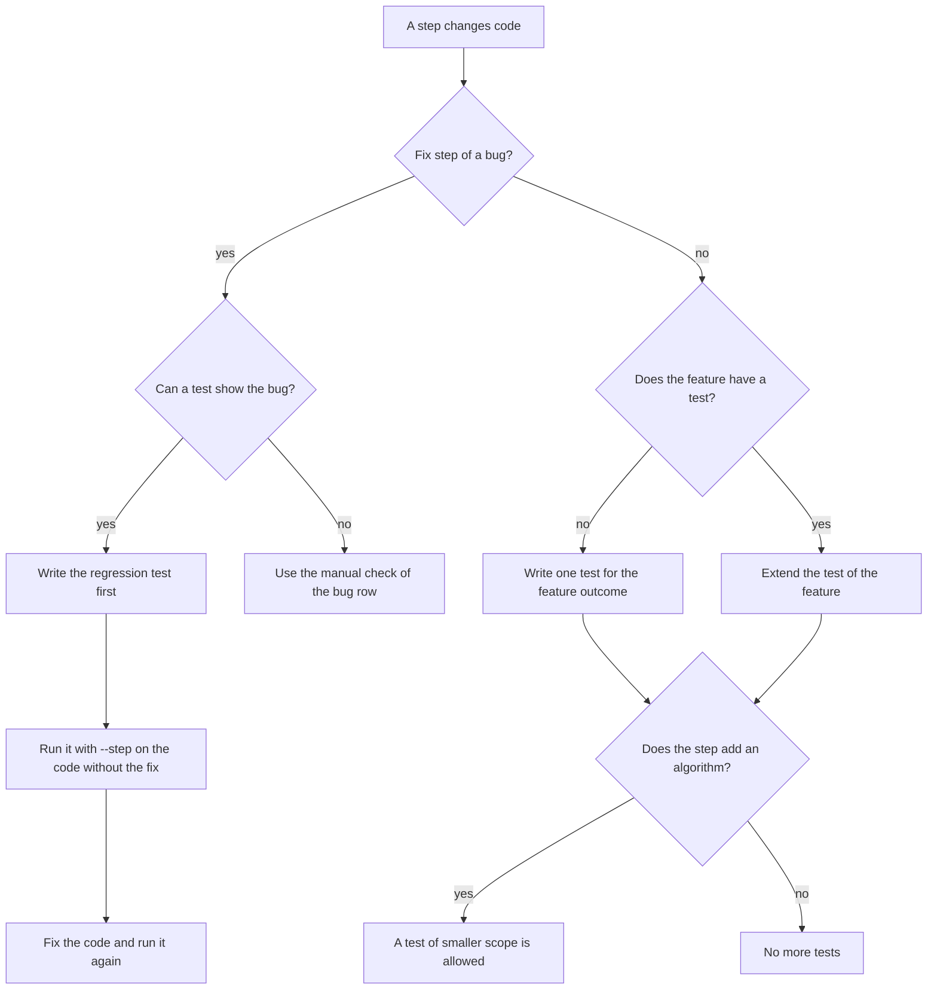

# Test conventions

Each rule has an id. A review problem names the id.

## Feature tests
| ID | Rule |
|---|---|
| T01 | Each feature has one test. The test checks one outcome that the user can see or measure. |
| T02 | A test checks the result, for example the shape of the output data or the scene after user actions. |
| T03 | A test does not read an internal state. |
| T04 | A test does not supply dummy data that skips a part of the changed code. |
| T05 | Write a test of smaller scope for an algorithm only. |
| T06 | Do not write a test for a setter, a getter or a utility. |
| T07 | A new property of a feature extends the test of the feature. Do not add a second test. |
| T08 | The name of a test is the name in its check: `TEST <name> passes`. |

## Fakes
| ID | Rule |
|---|---|
| T09 | A fake replaces an external system only: a database, a network service, the clock, the filesystem or a device. |
| T10 | A fake never replaces a function of the project under test. |
| T11 | Each boundary has one fake. The fake lives in the test support folder. |

## Regression tests
| ID | Rule |
|---|---|
| T12 | Each bug that a test can show has one regression test. The `Acceptance` column of the bug row names it. |
| T13 | The fix step writes the regression test before the fix. |
| T14 | The regression test fails on the code without the fix and passes on the code with the fix. |
| T15 | A regression test checks the result that the user sees, under the rules T02 to T04. |
| T16 | A regression test stays in the suite after a tool removes the bug row. |
| T17 | A bug that no test can show has a manual check as acceptance. |

## Test runs
`python -m tools.test` runs the test runner of the project. The commands of the runner are in `tools/project.toml`.

| ID | Rule |
|---|---|
| T18 | Run one test with `python -m tools.test <name>`. Run the suite with `python -m tools.test`. |
| T19 | Run the test of a step with `--step <step>`. The tool writes the evidence file. |
| T20 | In a fix step, run the regression test with `--step` before the fix and again after the fix. |

## Test selection

## Test runner
`project-init` writes this table.

| Runner | Support folder |
|---|---|
