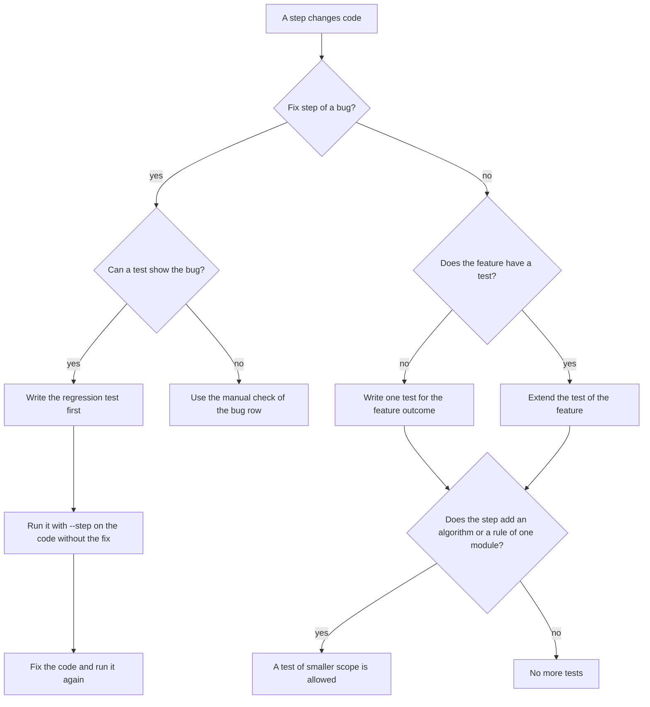

# Test conventions

Each rule has an id. A review problem names the id.

## Feature tests
| ID | Rule |
|---|---|
| T001 | Each feature has one test. The test checks one outcome that the user can see or measure. |
| T002 | A test checks the result, for example the shape of the output data or the scene after user actions. A test does not read an internal state. |
| T003 | A test does not supply dummy data that skips a part of the changed code. |
| T004 | Write a test of smaller scope for an algorithm, and for a rule of one module that the step adds or changes. A test of smaller scope calls the public functions of its module only. The feature test checks the outcome, and the smaller tests check the properties. |
| T005 | Do not write a test for a setter, a getter or a utility. |
| T006 | A new outcome of a feature extends the test of the feature. Do not add a second feature test. |
| T007 | The name of a test is the name in its check: `TEST <name> passes`. |

## Fakes
| ID | Rule |
|---|---|
| T100 | A fake replaces an external system only: a database, a network service, the clock, the filesystem or a device. A fake never replaces a function of the project under test. |
| T101 | Each boundary has one fake. The fake lives in the test support folder. |

## Regression tests
| ID | Rule |
|---|---|
| T200 | Each bug that a test can show has one regression test. The `Acceptance` column of the bug row names it. A bug that no test can show has a manual check as acceptance. |
| T201 | The fix step writes the regression test before the fix. |
| T202 | The regression test fails on the code without the fix and passes on the code with the fix. |
| T203 | A regression test checks the result that the user sees, under the rules T002 to T003. |
| T204 | A regression test stays in the suite after a tool removes the bug row. |
| T205 | A fix of a failing test removes the cause of the failure. A longer wait, a retry, a wider bound or a delay is not a fix. |

## Test runs
`python -m tools.test` runs the test runner of the project. The commands of the runner are in `tools/project.toml`.

| ID | Rule |
|---|---|
| T300 | Run tests with `python -m tools.test <name> [<name> ...]`, in one call for all names. Run a check line of the plan as it stands, for example `python -m tools.test "COMMAND <name> passes"`. Run the suite with `python -m tools.test`. |
| T301 | A test name matches one whole part of the name of a test. `--contains` runs each test whose name contains it. The output names each test that ran. |
| T302 | The tool runs a failed test three more times alone. `fails each time` names a steady defect, `fails in n of 4 runs` a test without a fixed result. Both fail the gate. A run with more than five failed tests runs none again, because so many failures share a cause. Never run a failed test again by hand to make a gate pass. |
| T303 | Run the test of a step with `--step <step>`. The tool writes the evidence file. |
| T304 | In a fix step, run the regression test with `--step` and `--fails` before the fix, then with `--step` after the fix. A run with `--fails` counts only when the build passes and the test fails. |
| T305 | A step runs its verification and the tests whose files it changes or adds. Nothing else. |
| T306 | A plan close runs the checks of its `Verification` section and the tests that the plan changed or added. The `COMMAND` checks run before the plan review too. Only the milestone close runs the whole suite. |
| T307 | A test covers the changed code when it calls, spawns or reads a changed module, type or function. The `Verification` section of a plan lists these tests, so the plan close runs them. |
| T308 | A test takes no fixed resource of the machine, for example a fixed port or a fixed file outside its own folder. It passes while other tests run. |
| T309 | The configuration of the test runner ends a test after the per-test timeout. `python -m tools.test` ends a run after `test_run_limit` seconds and reports the hang. |
| T310 | A failure of the whole suite at the milestone close is a bug. Run `bug-report` for it and fix it in a fix plan before the close. |

## Test selection

## Test runner
`project-init` writes this table.

| Runner | Support folder |
|---|---|
