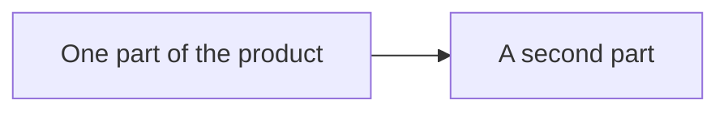

# Architecture overview

## What it does
Write here in a few lines what the architecture gives the product.

## How it works
Write here the parts, the data that flows between them and the order of the work.

## Where the code is
Write here a table of roles and paths.

## How to change or extend it
Write here one task per paragraph, with its steps.

## Gotchas
Write here what a developer gets wrong the first time.
